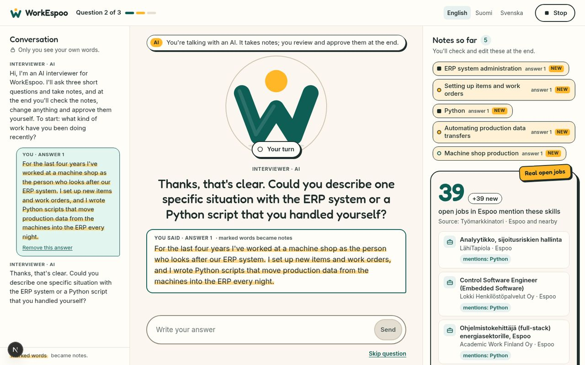
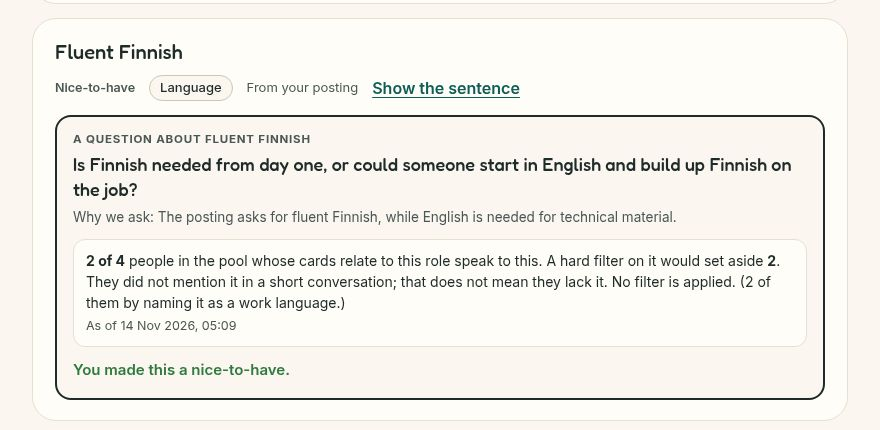
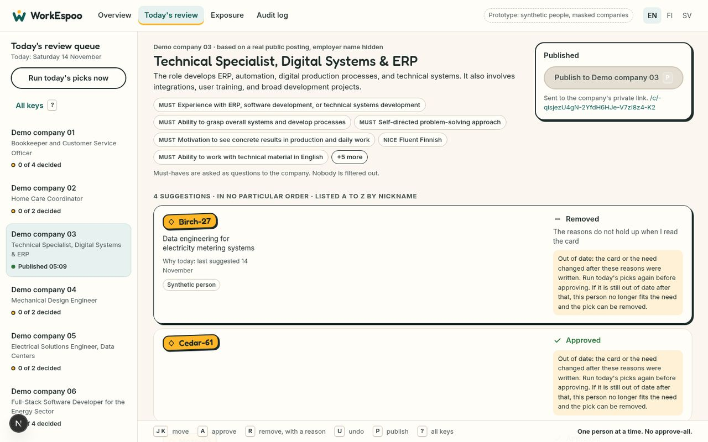

# WorkEspoo

A prototype for Junction 2026, City of Espoo challenge "Rethinking Recruitment". Live at **https://workespoo.aichat.fi**. Not an official City of Espoo service.

Registration for a matchmaking event becomes a short conversation with an AI interviewer instead of a CV form. Everything after it rests on what the person said: the real open jobs they are shown, and the short lists of people an Espoo organiser approves for each company. Nothing about a person is scored or ranked, and names stay hidden until both sides say yes.



## What it does

| | What it is | Who decides |
|---|---|---|
| **Signal Card** | A person's skills as short notes, each pointing at the sentences the person said. No scores, no levels, no name, no photo. | The person edits and approves it before anything uses it. |
| **Need Card** | A company's need, drafted from the real posting it already wrote: must-haves, nice-to-haves, and questions back to the employer with evidence from the pool. | The company answers or changes it. |
| **Daily Picks** | Per company, a short list of people worth a conversation, with reasons that pair the card with a sentence of the posting. | An Espoo organiser approves each person one by one. |

A must-have does not filter anyone out. It comes back to the employer as a question:



The organiser decides every suggestion, one person at a time. There is no approve-all, and a removal needs a reason:



## Try it

1. Open https://workespoo.aichat.fi and press **Start the conversation**. Type, or speak in Chrome. English, Finnish and Swedish work.
2. Check your notes on the card, approve it, and see open jobs in Espoo that relate to it.
3. The organiser's and the company's sides need the organiser passcode; the three-minute walk through all of it is in [`docs/specs/demo-script.md`](docs/specs/demo-script.md).

Whoever starts an interview on the live site is a live demo session: it needs consent and is deleted after 24 hours.

## What is real and what is not

| Real | Simulated or masked |
|---|---|
| The postings: about 1,300 open Espoo jobs from Job Market Finland (Työmarkkinatori), refreshed every six hours, with recruiter names, emails and phone numbers removed at ingestion | The people in the demo: 15 synthetic personas. Each was interviewed by the real interviewer and went through the real pipeline, and each is labelled "Synthetic person" |
| The model calls: every interview, card and Need Card in the demo was made by the real model | The companies: 8 real postings shown as "Demo company 01" to "08" with the employer's name hidden, because no employer was asked |
| Matching through the ESCO skills taxonomy, the review queue, mutual consent, the audit log | Email: nothing is sent; a company's list is a private link. Event agenda and meeting slots are not built |

## Rules the code enforces

1. Nothing about a person is scored, ranked or levelled. Lists of people are in no particular order.
2. Evidence is cited by reference: the model points at a turn and a sentence, and code renders the text from the stored transcript. Model wording is never shown as a quote.
3. Age, gender, nationality, ethnicity, religion, health, family status and photo are never stored on a card or shown. The interview language and whether someone spoke or typed are not shown to a company or an organiser; a company sees the person's own words only after both sides agreed.
4. A person approves their own card before anything uses it, and can download or delete everything.
5. A human approves every pick individually. Must-have requirements never filter anyone out of the pool.
6. Job ingestion drops personal data, including contact details inside description text.
7. No voice, tone or emotion analysis. Audio is never stored.
8. The app never calls a closed model API: every model call goes through one gateway to an OpenAI-compatible endpoint (today the open-weight Kimi K3.1 served by Verda from Finland).

The public page [`/how-it-works`](https://workespoo.aichat.fi/how-it-works) says the same in plain words, in three languages.

## How it is built

One TypeScript package, four containers on one small server (2 cores, 4 GB).

| Piece | Choice |
|---|---|
| Web | Next.js 16 (App Router), React 19, Tailwind 4; server-sent events for the live interview |
| Worker | The same code as a second process: ingestion, Need Card drafting, matching, daily drafts, the 24-hour purge |
| Database | Postgres 17 with `pg_trgm`; Drizzle for schema and migrations; PGlite for tests |
| Model gateway | `src/lib/llm`: three roles (live, analyst, bulk) as priorities under one shared rate limit, a deadline on every call, JSON validated with Zod, an audit row per call |
| Voice | The browser listens (push to talk); the server speaks with Piper in English, Finnish and Swedish. No key needed |
| Proxy and deploy | Caddy with automatic TLS; `git push` to the server builds, migrates, swaps and rolls back on a failed health check |

```
src/contracts    every shape that crosses a boundary (API, database json, events, model output)
src/lib          the shared library: model gateway, queue, audit, redaction, ESCO, i18n
src/features     interview, card, jobs, needs, matching, picks, intros, voice, synth
src/app          pages and thin route handlers
src/components   the design system as React components (gallery at /dev/design)
seed/            the synthetic personas and the snapshot the demo reset restores
e2e/             the demo as a test, and the scripts that record it as a video
docs/            specs, decisions, the design system, the demo script, pitch notes
```

## Checks

| Command | What it does |
|---|---|
| `npm run check` | type check, lint and about 1,400 unit tests (Vitest, in-process Postgres) |
| `npx playwright test golden-path` | the whole demo against a real deployment with the real model (see the demo script for the environment it needs) |
| `npm run sim -- --n 15 --db` | simulated interviews against the interview rubric; reports are in [`evals/`](evals/) |
| `npm run seed` | builds the demo world; `--snapshot` saves it, `--reset` restores it without a model |

## Where to read more

- [`docs/PITCH.md`](docs/PITCH.md): what it is for, measured numbers, and answers to likely questions
- [`docs/specs/demo-script.md`](docs/specs/demo-script.md): the three-minute demo
- [`docs/design/DESIGN.md`](docs/design/DESIGN.md): the design system
- [`docs/LEAD-DECISIONS.md`](docs/LEAD-DECISIONS.md): decisions taken while building, with reasons
- [`docs/STATUS.md`](docs/STATUS.md): the progress board
- [`docs/PLAN.md`](docs/PLAN.md): the original plan

## Limits we know about

- The job data comes from the website's own endpoints of Työmarkkinatori. Production use needs its official API, which an employment authority can onboard to.
- One model provider with 40 requests a minute carries everything. It is enough for a demo and a few people at once.
- Recruitment is a high-risk use under the EU AI Act. The design assumes those obligations apply; no conformity assessment has been done.
- The Finnish and Swedish wording was written by the builders and wants a native reader.
- Not built: the event agenda, email delivery, an organiser adding a person by hand, and a test that swaps names and languages to check that picks do not change.

## Sources and credits

Job postings: Lähde: Työmarkkinatorin asiakastietojärjestelmä (Job Market Finland). Skills taxonomy: ESCO, European Commission. Speech: Piper with the voices en_GB-cori, fi_FI-harri and sv_SE-nst.
