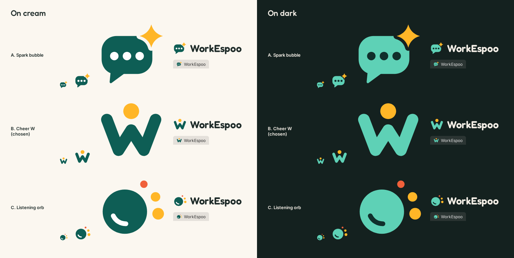

# WorkEspoo brand starter

## The mark: "Cheer W"

A rounded W drawn as one thick line, with a sun-yellow dot above the middle
peak. It reads as the letter W and as a person with both arms up. It is two
shapes and two colours, so it stays clear at 16 to 24 pixels.

Why this one: it was the clearest of the three at favicon size. It is about
the person, not the software: someone pleased after a short talk that went
well. It also avoids the chat-bubble look that every messaging app uses.

| File | Use |
|---|---|
| `public/brand/mark.svg` | Mark on light backgrounds (pine + sun) |
| `public/brand/mark-dark.svg` | Mark on dark backgrounds (mint + sun) |
| `src/app/icon.svg` | Favicon; switches to mint when the browser is in dark mode |
| `src/components/brand/Logo.tsx` | `<Logo size={32} showWordmark />`, the mark plus the wordmark as live text |
| `public/brand/alt-1.svg` | Runner-up A, "Spark bubble": a speech bubble with typing dots and a spark escaping the corner |
| `public/brand/alt-2.svg` | Runner-up C, "Listening orb": a round shape with a soft curve and skills orbiting into view |

The wordmark is "WorkEspoo" as one word in a single colour (ink on light,
cream on dark). Do not colour "Espoo" on its own: that would draw attention to
the city's name and make the prototype look like an official city service.

## Palette

| Role | Name | Hex | Use | Contrast |
|---|---|---|---|---|
| Primary | Pine | `#0E5E55` | Buttons, links, the mark's W | white on pine 7.63:1; pine text on cream 7.15:1 |
| Accent | Sun | `#FFB627` | Highlights, the mark's head, small badges. Never as text on light backgrounds | ink on sun 8.36:1 |
| Background | Cream | `#FBF7F0` | Warm page background | (background) |
| Text | Ink | `#1E2B29` | Body text and headings | ink on cream 13.72:1 |
| Success | Leaf | `#2F7A3E` | "Saved", "sent" and other confirmations | leaf text on cream 4.95:1; white on leaf 5.28:1 |
| Caution | Amber | `#9A5B00` | Notes that need attention (never used to judge a person) | amber text on cream 5.08:1; `#8A5300` on `#FFF1D6` 5.67:1 |
| Dark mode | Mint / Night | `#5ED1B6` / `#14211F` | Mint replaces pine on the night background | mint on night 8.90:1; cream on night 14.35:1 |

Coral `#F0603A` appears only in the runner-up marks. Do not use it for text:
ink on coral is 4.49:1, which is below the minimum.

Ratios are WCAG 2 relative-luminance contrast and meet 4.5:1 for normal text.

## Fonts

- **Wordmark and headings: Fredoka** (600 for the wordmark, 500 for headings), through
  `next/font/google` in `src/components/brand/fonts.ts` as `--font-brand`. Its rounded,
  open letters feel friendly and a little playful but stay easy to read, which suits
  a tool that should never feel corporate.
- **Body: Inter**, already loaded as `--font-sans`. Neutral and very easy to read in
  long text and in form fields.

## Using the mark

Do:

1. Leave clear space around the mark of at least the head's diameter (about an eighth of its height).
2. Use `mark.svg` on light backgrounds and `mark-dark.svg` on dark ones.
3. Keep the mark at 16 px or larger, and set the wordmark as live text with `<Logo />`.

Do not:

1. Recolour, stretch, rotate or outline the mark, or add a gradient or shadow.
2. Pair it with the City of Espoo emblem or the city's blue, or place it where it could look like an official city service.
3. Put the mark on a busy photo or on a mid-tone background where neither variant has clear contrast.
